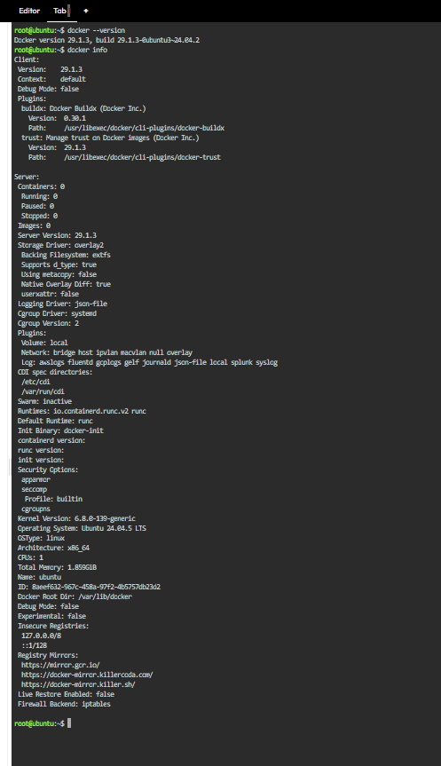
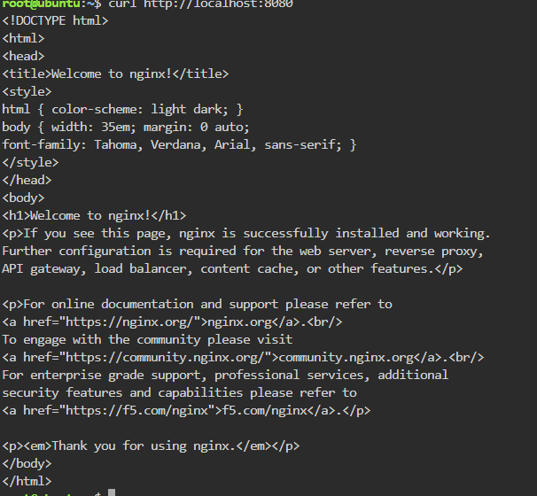
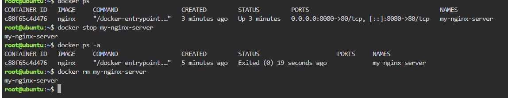

# 🚀 Docker Deployment & Container Lifecycle Guide

> **Engineer:** Christopher Sean Gutierrez  
> **Environment:** KillerCoda (Ubuntu Docker Playground)  

---

## 🔄 Container Lifecycle Management Commands

1. `docker ps`  
   **Explanation:** Lists all currently active and running containers on the host system, displaying container ID, image, port mappings, and runtime status.

2. `docker stop my-nginx-server`  
   **Explanation:** Sends a graceful termination signal (`SIGTERM`) to halt execution of the target running container without destroying its data.

3. `docker ps -a`  
   **Explanation:** Displays all containers on the system, including running, paused, and stopped containers.

4. `docker rm my-nginx-server`  
   **Explanation:** Permanently deletes the stopped container instance and frees associated system metadata.

---

## 🖼️ Visual Evidence

### Verification

### Live Application Execution

### Lifecycle Execution

