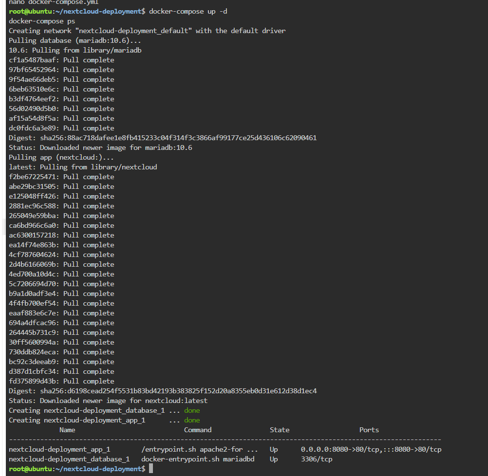
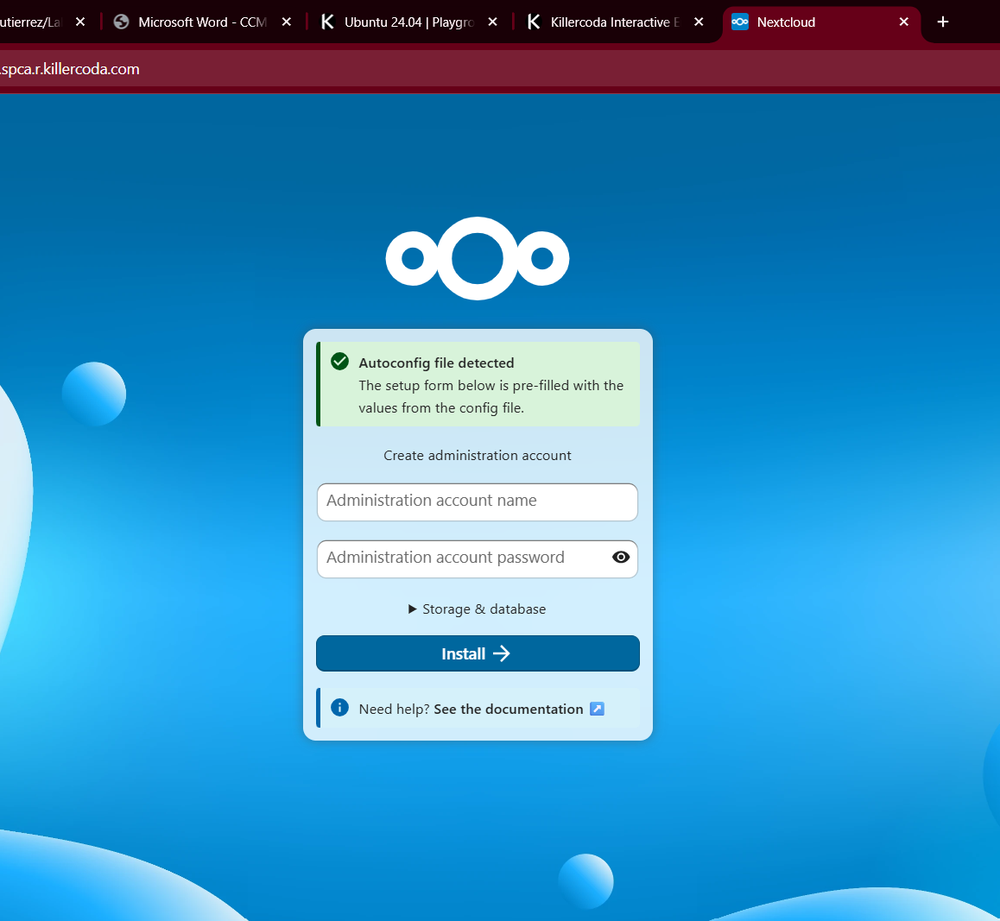
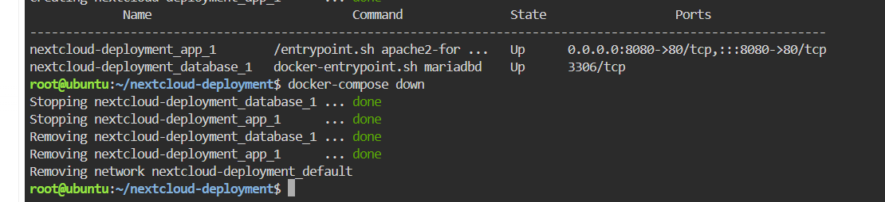

# 🐳 Docker Compose & Infrastructure as Code Guide

> **Engineer:** Christopher Sean Gutierrez  
> **Environment:** KillerCoda Ubuntu Playground  
> **Project:** Nextcloud & MariaDB Multi-Tier Stack  

---

## 🔍 Technical Analysis of the Compose Blueprint

### 1. What does the `services:` block do?
The `services:` block defines the individual containers that make up the multi-container application stack. Each key underneath it (`database` and `app`) represents a separate container service managed by Docker Compose, allowing engineers to configure their images, network ports, and environment parameters in a single unified file.

### 2. How did the Nextcloud app container find the database container?
The Nextcloud application container successfully located the MariaDB database container using Docker's built-in automatic service discovery and DNS resolution. By setting the environment variable `MYSQL_HOST=database`, the application container resolved the hostname `database` directly to the internal IP address of the database service container on the default bridge network without requiring hardcoded IP addresses.

### 3. What is the difference between `docker run` and `docker-compose up -d`?
* **`docker run`** launches a single container instance manually via lengthy CLI command strings containing all port flags, environment variables, and network options.
* **`docker-compose up -d`** reads a declarative YAML configuration file (`docker-compose.yml`) to provision, configure, network, and launch an entire multi-container application stack simultaneously in the background with a single command.

---

## 🖼️ Visual Evidence

### Stack Deployment

### Web Interface Access

### Infrastructure Teardown

